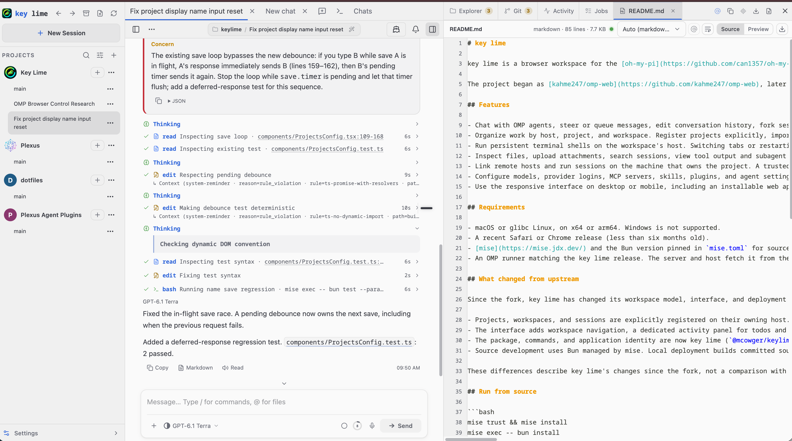
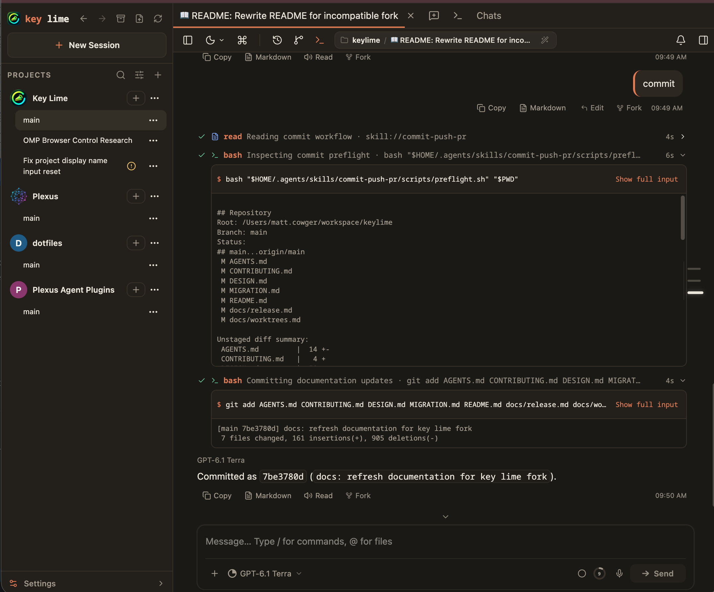
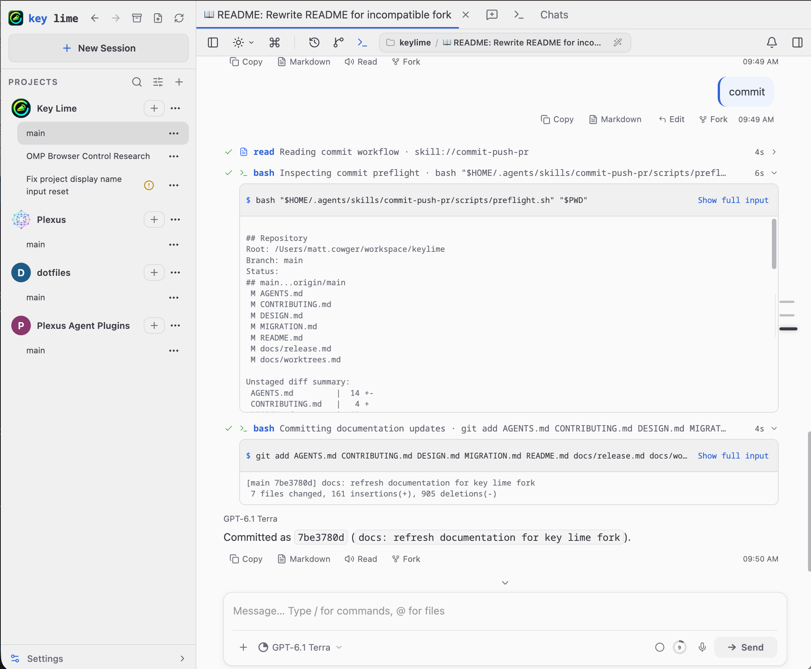
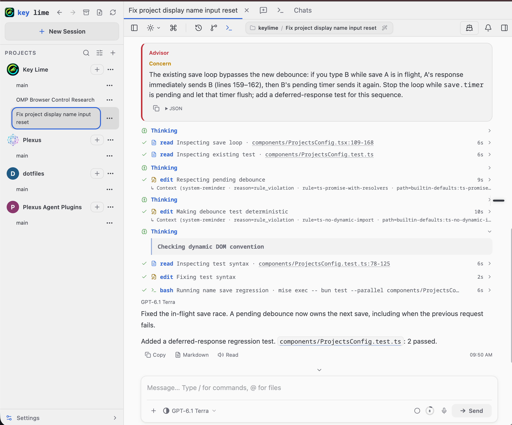
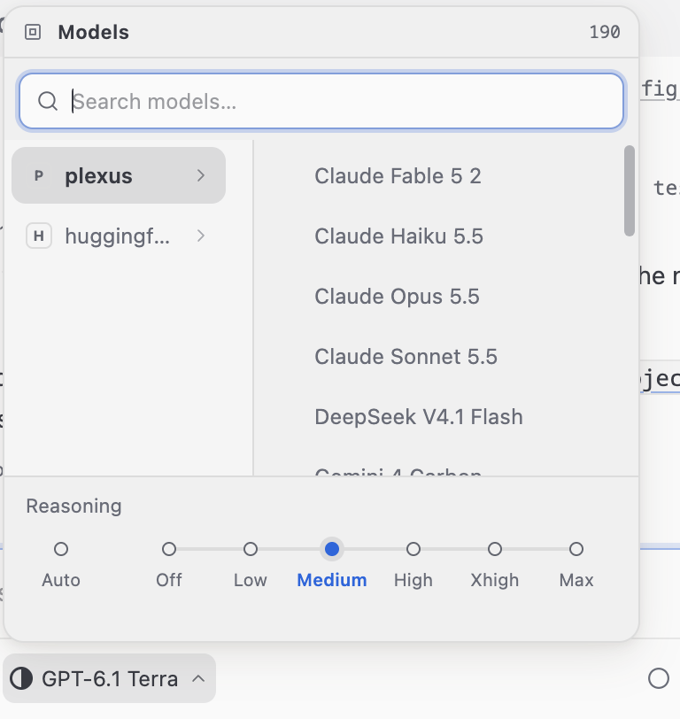
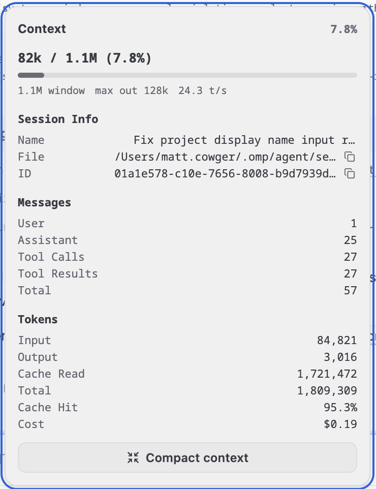
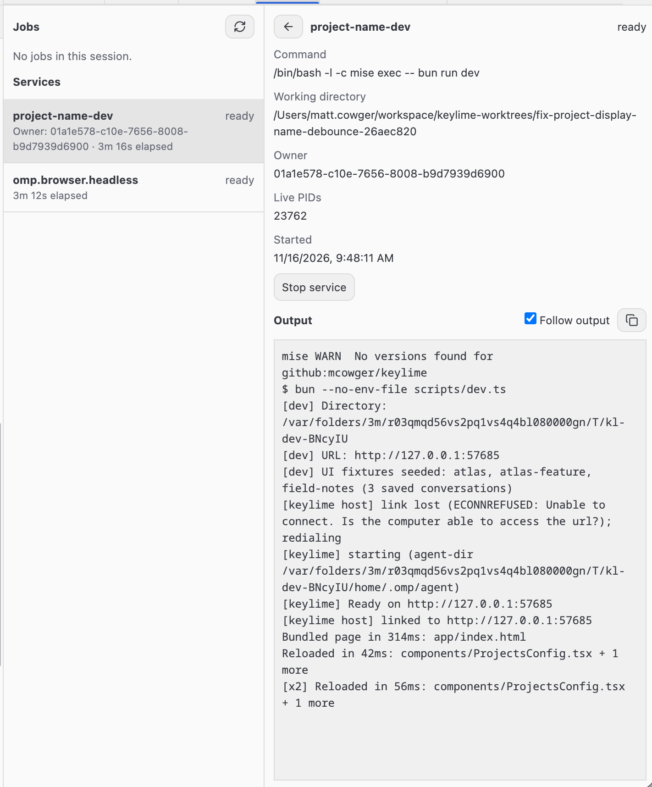
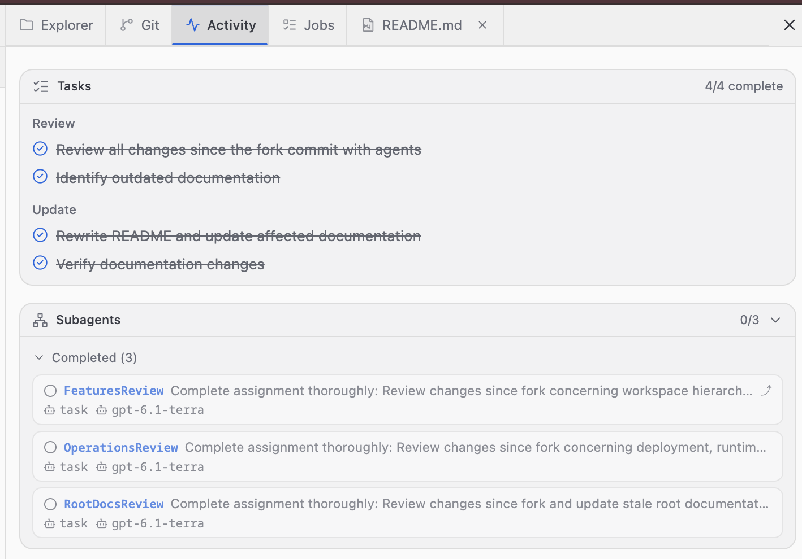
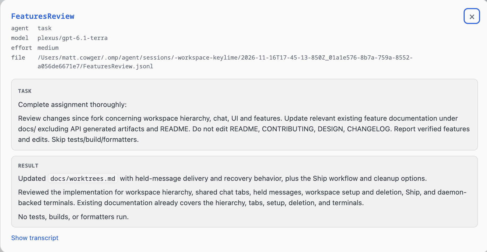
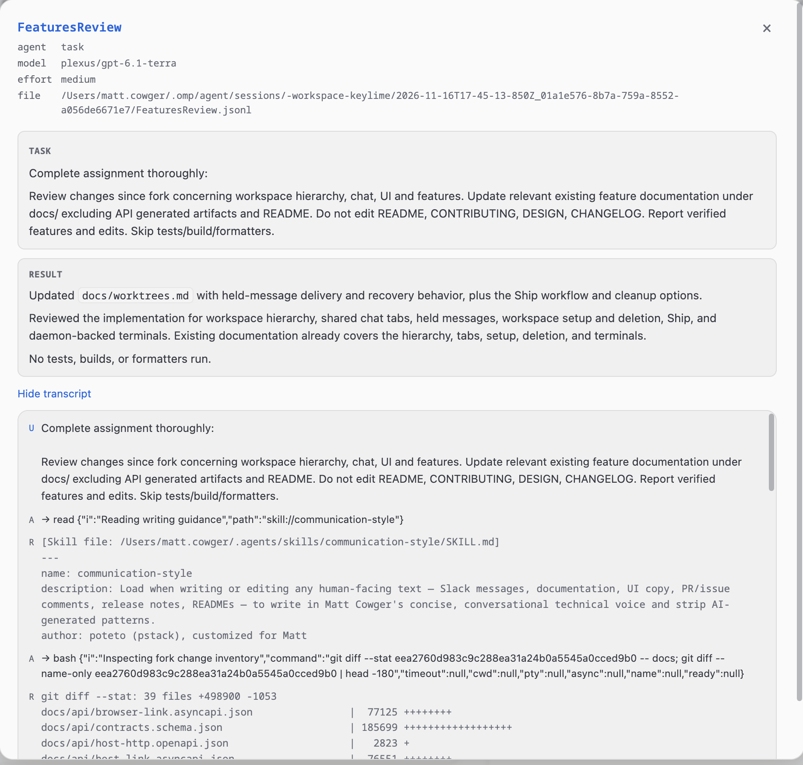

<h1> key lime</h1>

key lime is a browser workspace for the [oh-my-pi](https://github.com/can1357/oh-my-pi) coding agent. It runs agents on your own machines and lets you work with their sessions, projects, files, terminals, and Git worktrees from a browser.



The project began as [kahme247/omp-web](https://github.com/kahme247/omp-web), later developed as [ompweb](https://github.com/ompweb-dev/ompweb). Thanks to its authors and contributors for the original project. [mcowger/keylime](https://github.com/mcowger/keylime) is now an independently maintained, intentionally incompatible hard fork. It is not a drop-in replacement for upstream: configuration, data, APIs, commands, and deployments may diverge without migration or backward compatibility. Back up agent data before changing installations or rolling back.

Thanks to [omercnet](https://github.com/omercnet) and the [Paseo shared browser plugin](https://github.com/omercnet/paseo-plugins/tree/HEAD/paseo-shared-browser) for the encoded browser video idea and capture implementation that inspired key lime's viewer.

## Features

- Chat with OMP agents, steer or queue messages, edit conversation history, fork sessions, and ask side questions with `/btw`. Existing-session messages are held in an outbox until delivery is confirmed; uncertain delivery remains visible rather than being silently retried.
- Switch between Build and Plan modes, then approve a proposed plan or request revisions. Plan mode does not sandbox shell commands or extensions.
- Select workspace chat roles in the model picker. The session-only Auto Prewalk control can report OMP's recommended model handoffs or enable them without changing the starting model.
- Organize work by host, project, and workspace. Register projects explicitly, import existing worktrees and sessions selectively, and use multiple chats and terminals in a workspace. Git workspaces support prompt-first creation, configurable setup commands, and Paseo recipes. See [projects and workspaces](docs/worktrees.md).
- Group repositories, shared instructions, and service commands into a System. Create an Effort to work across coordinated branches and worktrees, with a root chat and service terminals. See [Systems and Efforts](docs/worktrees.md#systems-and-efforts).
- Keep Markdown notes and a task board outside Git on the owning host. Improve a task brief and launch it as the first prompt in a new Workspace or Effort. See [Notes and Tasks](docs/worktrees.md#notes-and-tasks).
- Run persistent terminal shells on the workspace's host. Switching tabs or restarting the web server does not stop them; restarting the host daemon does.
- Attach to the same live OMP session from the browser and the native terminal with `klc`, including across linked hosts. Multiple terminal clients share the host-owned screen and input. See [terminal attachment](#terminal-attachment-with-klc).
- Watch an agent's Chromium page in a workspace Browser tab and take shared control without pausing the agent. Video streams when available, with snapshots as a fallback. See [chat tabs](docs/worktrees.md#chat-tabs).
- Inspect files, upload attachments, search sessions, view tool output and subagent activity, and follow todo progress. The live Jobs panel shows background jobs, services, process details, and output; cancel owned jobs or stop services from the panel.
- Ship changes from a workspace by landing locally or opening a pull request. Optionally monitor PR comments and reviews and send feedback links to a workspace chat; monitoring can also be started or stopped independently of Ship. Agents can inspect the workspace's linked PR and start monitoring without a browser or confirmation; with Agent tools enabled on the host they can also link an existing PR. See [PR monitoring](docs/specs/2026-11-20-ship-pr-monitoring-design.md).
- Link independent remote hosts and choose where each session runs. Each host uses its own settings, plugins, environment, and provider logins.
- Configure models, provider logins, MCP servers, skills, plugins, and agent settings. Get browser notifications for completed runs, requests for input, and failures.
- Use the responsive interface on desktop or mobile, including an installable web app, light and dark themes, and per-browser display settings.

## Screenshots

| View                                                        | Screenshot                                                          |
| ----------------------------------------------------------- | ------------------------------------------------------------------- |
| A conversation alongside the project and workspace sidebar. |      |
| Tool calls and commit output in a conversation.             |    |
| An advisor finding in an active coding session.             |   |
| Model selection and reasoning effort controls.              |   |
| Context usage, session statistics, and compaction.          |  |
| Running services and their output in the Jobs panel.        |            |
| Tasks and subagents in the Activity panel.                  |       |
| A subagent's task and result.                               |              |
| The same subagent with its transcript expanded.             |          |

## Requirements

- macOS or glibc Linux, on x64 or arm64. Windows is not supported.
- A recent Safari or Chrome release (less than six months old).
- [mise](https://mise.jdx.dev/) and the Bun version pinned in `mise.toml` for source development. A compiled release embeds Bun.
- An OMP runner matching the key lime release. The server and host fetch it from the project's GitHub release when missing; `keylime fetch-omp` fetches it explicitly. Source development requires building the runner as described below.

## What changed from upstream

Since the fork, key lime has changed its workspace model, interface, and deployment tooling:

- Projects, workspaces, and sessions are explicitly registered on their owning host. Existing worktrees and sessions require selective import. Workspaces have chat and persistent terminal tabs, prompt-first creation, and configurable setup pipelines, including Paseo recipes.
- The interface adds workspace navigation, a dedicated activity panel for todos and subagents, model activity and reasoning controls, adjustable chat width, and a workspace-scoped Ship workflow.
- The package, commands, and application identity are now key lime (`@mcowger/keylime` and `keylime`). English is the only interface language; Windows and system tray support have been removed.
- Source development uses Bun managed by mise. Local deployment builds committed source into versioned releases and supports frontend-only updates. GitHub Actions are disabled; verification and releases run locally.

These differences describe key lime's changes since the fork, not a comparison with every subsequent upstream release. No compatibility or data migration is promised.

## Run from source

```bash
mise trust && mise install
mise exec -- bun install
mise exec -- bun runner/scripts/build-binary.ts
mise exec -- bun run dev
```

The development launcher prints its URL and temporary directory. It starts a hot-reloading web server and a separate host daemon with isolated HOME, agent data, and sample projects and sessions. It does not copy your existing projects, sessions, or logins. Stop it with Ctrl-C; the temporary directory remains for inspection.

For a production build from this checkout:

```bash
mise exec -- bun run build
mise exec -- bun run start
```

The default address is `http://127.0.0.1:30177`. Start the host daemon separately for live sessions. The web server and daemon are separate processes: restarting the web server leaves agent runs on the daemon running; restarting the daemon stops them.

The package and compiled binary use the `keylime` command. For a foreground installation, start `keylime` first and then `keylime host` in another terminal. `keylime systemd install` and `keylime launchd install` install both services on Linux and macOS respectively. `keylime --help` lists server options; `keylime hash-password` creates a password hash.

## Terminal attachment with `klc`

`klc` connects your terminal to a live key lime session, including one running on a remote host. The browser and terminal use the same OMP agent session: messages and activity appear in both. The terminal runs the native OMP TUI on the host, while the browser uses the structured session channel; it doesn't scrape the terminal screen. No separate terminal multiplexer is required.

Multiple `klc` clients can attach to the same session. They share one screen, input stream, and terminal size; the most recent resize applies to everyone. The host daemon keeps the session running when clients detach or the web server restarts. Restarting the host daemon stops it.

Build the standalone client from source, then connect to a server:

```bash
mise exec -- bun scripts/build-klc-binary.ts
./release/klc-<os>-<arch>/klc --url https://keylime.example.com
./release/klc-<os>-<arch>/klc --url https://keylime.example.com --host HOST SESSION_ID
```

To make `klc` available on your PATH, link the built binary from the checkout. For example, on macOS arm64:

```bash
mkdir -p "$HOME/.local/bin"
ln -s "$(pwd)/release/klc-darwin-arm64/klc" "$HOME/.local/bin/klc"
```

Replace `darwin-arm64` with your build target (`darwin` or `linux`, and `arm64` or `x64`). Add `$HOME/.local/bin` to your PATH if needed. The link depends on the checkout staying in place; rebuilding updates the linked binary. If `klc` already exists there, `ln` refuses to replace it.

`KEYLIME_URL` sets the server URL when `--url` is omitted; the default is `http://127.0.0.1:30177`. Set `KEYLIME_PASSWORD` to authenticate without a prompt; otherwise the client prompts when needed. Remote HTTP requires `--insecure` and sends credentials and terminal traffic without encryption, so use a trusted HTTPS endpoint.

The picker searches sessions across linked hosts. Press Tab to cycle through running, archived, and all sessions, or Ctrl-N to create a session in a registered workspace. Press Ctrl-] to detach back to the picker, then Ctrl-] again to exit. `/quit` ends the shared runtime for everyone. Ctrl-D and a rapid second Ctrl-C are blocked to prevent accidental termination.

On reconnect, `klc` restores a fresh screen snapshot rather than replaying input whose delivery is uncertain. Terminal protocol support is intentionally limited; see [the terminal design](docs/terminal.md) for architecture and fidelity limitations.

## Security and remote hosts

Password authentication is optional on every bind address. Without it, anyone who can reach the server can use its agent and file capabilities. Set `KEYLIME_PASSWORD_HASH` to the output of `keylime hash-password`, and use HTTPS through a trusted reverse proxy or VPN for remote access. Never put a plaintext password in a command-line argument.

The browser connects through `/api/events/link`; host daemons connect through `/api/hosts/link`. A reverse proxy must forward WebSocket upgrades. Browser connections can fall back to server-sent events. `/api/hosts/link` authenticates daemon tokens itself.

To add a machine without installing the web server or browser assets, follow the [remote host deployment guide](docs/remote-host-deployment.md). A daemon connects to one controller and keeps runs alive across controller restarts. The controller can manage several hosts and deploy binaries without sharing their configuration.

## Deployment and development

Local production deployment builds committed HEAD in a separate directory. Full activation drains active work for up to 60 seconds before forcibly stopping remaining runs; frontend-only deployment avoids restarting services when the entire change is limited to supported browser files. Deployment does not back up agent data. See [local deployment](docs/local-deployment.md) for prerequisites, rollback, recovery, and limits.

```bash
mise exec -- bun run test          # parallel Bun tests
mise exec -- bun run typecheck     # application and runner
mise exec -- bun run format:check
mise exec -- bun run release:check # formatting, types, tests, build, smoke
```

Live-agent tests and the smoke check require the runner build. GitHub Actions workflows are disabled; checks and releases are run locally. See [contributing](CONTRIBUTING.md), the [release checklist](docs/release.md), and [design](DESIGN.md).

HTTP, host, browser, and runner contracts live in `lib/api-contracts/`. Generated API documents are checked in under [docs/api](docs/api/). After changing contracts or their documented semantics, run `mise exec -- bun run api`. Normal builds and releases do not regenerate or check those documents.

## License

[MIT](LICENSE).
