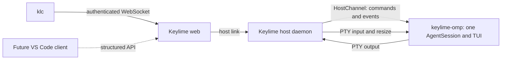

# Shared sessions and native terminal attachment

## Status

Keylime starts the native OMP TUI in a host-owned PTY. `klc` attaches through the web server, including when the terminal runs on another machine.

The goal is one live OMP session that can be used from Keylime, the native OMP TUI, and eventually other clients at the same time. The proof starts the real OMP TUI in a PTY and exposes the same session through Keylime's existing structured channel. It does not modify upstream OMP, implement a new TUI, or require a terminal multiplexer.

## Completion plan

The implementation follows this design:

- Ship `klc` as a standalone compiled client for macOS and glibc Linux on x64 and arm64. It connects to the Keylime web server, not directly to a host socket. A command-line URL overrides the environment; the default is `http://127.0.0.1:30177`. Remote plaintext requires an explicit insecure option.
- Use the server's existing password login with an in-memory session cookie. The server authenticates the connection and routes terminal traffic to the owning host. Reconnect with a fresh screen snapshot and never replay input whose delivery is uncertain.
- Use a terminal UI library for a searchable picker modeled on OMP's resume screen. Show registered unarchived sessions by default; Tab cycles through running PTYs, registered sessions, all archives and all discovered sessions. Search title, project, workspace, host and ID. Identify unavailable hosts rather than hiding the incomplete inventory.
- Resume inactive sessions and restore archived sessions through Keylime's existing safety checks. Create new blank sessions in registered workspaces with normal launch defaults, register them in the hierarchy and attach to their OMP composer.
- Keep one PTY per session and share its screen, input and dimensions between terminal clients; the latest resize wins. `Ctrl-]` detaches to the picker and exits from the picker. `/quit` ends the shared runtime.
- Block `Ctrl-D` and a rapid second `Ctrl-C` at the daemon's shared PTY input gate, including across clients and reconnects. Tell the user to detach with `Ctrl-]` or end the runtime with `/quit`. Blocking `Ctrl-D` also prevents its forward-delete behavior.
- Cover creation, discovery, authentication, host routing, lifecycle, reconnect, concurrent clients, terminal control sequences, backpressure and failure paths with automated tests. Update API contracts and generated documents, release packaging and user documentation; verify the compiled client and the actual terminal interface.

## How to try it

Build the standalone client with `bun scripts/build-klc-binary.ts`, then run `klc` in a terminal:

```sh
klc --url https://keylime.example.com
klc --url https://keylime.example.com --host HOST SESSION_ID
```

`KEYLIME_URL` supplies the server URL when `--url` is absent; the default is `http://127.0.0.1:30177`. Remote HTTP requires `--insecure`. When password authentication is enabled, `KEYLIME_PASSWORD` supplies the password if set; otherwise the client prompts without echo. An incorrect environment password fails rather than prompting. The session cookie stays in memory. Use a trusted TLS endpoint: the insecure option sends terminal traffic and credentials without encryption.

The picker searches sessions across linked hosts. Tab changes the session view; Ctrl-N lists registered workspaces, including non-default worktrees, for creating a blank session. `Ctrl-]` detaches to the picker, then exits from the picker. `/quit` ends the shared runtime for every client. `Ctrl-D` and a rapid second `Ctrl-C` are blocked at the host PTY input gate.

## Architecture



There is one `AgentSession` and one agent loop per runtime. Keylime sends commands and receives session events over the structured channel. Terminal input and output use a separate PTY channel. The web UI does not scrape terminal output, and the terminal client contains no agent logic or OMP UI implementation.

A browser message enters the same session displayed by the TUI; a message entered in the TUI is emitted on the structured channel for Keylime. The terminal runs on the host, so OMP commands and tools operate there. Multiple structured clients remain possible through the existing channel member and event fan-out. Multiple terminal attachments share the same PTY and therefore the same screen, input stream, and dimensions; the latest resize affects the shared PTY. Independent terminal views and resize arbitration are not implemented.

## Launch and identity

1. `lib/hosts/daemon.ts` creates `SessionPtyManager` and starts its attach socket alongside the existing OMP host socket.
2. The daemon uses `prepareInteractiveLaunch` in `lib/hosts/local-host.ts` to resolve the runner, working directory, environment, session arguments, model, profile, and workspace launch configuration. It launches the runner **without** `--headless` in a PTY. This changes the daemon's normal session launch path; it is not an opt-in mode.
3. `runner/src/session.ts` already wraps the TUI's `AgentSession` with `HostChannel`. The runner connects to the host socket and sends its existing `hello` frame.
4. The daemon matches that hello to its pending PTY launch by PID. It completes the pending launch instead of treating the connection as an externally started TUI or creating a second channel. A separate runtime UUID identifies the PTY and channel after association.
5. `ChannelTable` binds the session ID to that runtime, including when the session identity changes. Attach resolves the session ID through this mapping. The runner's structured channel still addresses the same `AgentSession` as the TUI.

A failed or timed-out launch terminates its child. The daemon owns managed PTY processes; loss of the managed runner's host socket terminates that process. Daemon shutdown closes attachments and stops managed PTYs. The existing adoption path for independently started TUI runners is separate from the managed PTY path.

## Terminal attachment

`lib/hosts/session-pty.ts` owns each PTY, an `@xterm/headless` screen, a serializer, and its attached sockets. It starts at 80 columns by 24 rows with `TERM=xterm-256color` and `COLORTERM=truecolor`. The first attach supplies the client dimensions and resizes both the screen and PTY.

The emulator consumes output continuously, even with no native terminal attached. On attach, the manager drains queued screen writes, resizes, serializes the current screen, and sends a snapshot before adding the socket to live output delivery. A reconnect takes a fresh snapshot rather than replaying uncertain input.

`runner/src/klc.ts` provides the picker and terminal client. It restores local terminal state on detach or exit.

### Terminal queries and capabilities

The server-side emulator is the terminal-query responder, both before and after a client attaches. The PTY manager feeds output to the emulator and writes its replies back to the PTY. `ControlFilter` retains incomplete escape sequences across chunks and filters selected terminal queries from client output and selected reply sequences from client input. OSC palette and foreground/background/cursor color replies are implemented in the manager.

This is a deliberately narrow terminal-protocol implementation, not a guarantee of full terminal fidelity. In particular, the filter suppresses Kitty keyboard protocol and `modifyOtherKeys` negotiation because the headless emulator does not implement them. Input filtering also removes OSC and DCS sequences. The screen serializer and mode restoration need broader validation for clipboard, images, mouse, paste, keyboard protocols, terminal queries, and terminal-specific extensions. Do not replace the filtering with regex substitutions over arbitrary chunks: escape sequences can be split across writes, and two responders can corrupt cursor and capability state.

## Protocols

### Existing structured channel

This proof reuses Keylime's runner-to-host NDJSON protocol; it does **not** add OMP RPC mode or change the runner protocol version. `HostChannel` sends `hello`, session events, UI requests, and responses; the host sends commands and UI answers. Existing fan-out, message correlation, pending-dialog handling, and streaming snapshots remain in the Keylime channel layer. Dialogs mirrored between the local TUI and host settle on the first answer.

The important change is transport topology: daemon-spawned sessions now have a PTY for the TUI and use the runner's Unix-socket `HostChannel`, rather than the headless runner's stdio channel. `runner/src/channel.ts` documents the existing frames.

### Host-local attachment protocol

The daemon listens at the OMP host socket path plus `.attach`. The normal host socket is `KEYLIME_HOST_SOCKET` when set, otherwise `<XDG_RUNTIME_DIR or OS temp dir>/keylime/host.sock`. The attachment socket and its directory are restricted to the host user; this is local filesystem access control, not a network authentication protocol.

The attachment connection is newline-delimited JSON. The current messages are:

| Direction | Message | Purpose |
| --- | --- | --- |
| Client → daemon | `{ "type": "hello", "sessionId": "…", "cols": 80, "rows": 24 }` | Resolve a running session and begin attachment. |
| Daemon → client | `{ "type": "snapshot", "data": "…", "cols": 80, "rows": 24, "cursor": 0 }` | Restore the current terminal screen. |
| Daemon → client | `{ "type": "output", "data": "…", "cursor": 1 }` | Deliver subsequent terminal output. |
| Client → daemon | `{ "type": "input", "data": "…" }` | Forward terminal input to the PTY. |
| Client → daemon | `{ "type": "resize", "cols": 100, "rows": 30 }` | Resize the shared screen and PTY. |
| Client → daemon | `{ "type": "detach" }` | Close this attachment, not the OMP process. |
| Daemon → client | `{ "type": "exit", "code": 0 }` or `{ "type": "error", "message": "…" }` | Report process exit or an attachment error. |

The local protocol is private to the daemon. The web server bridges authenticated `klc` WebSockets at `/api/terminal/attach` to the owning host through host link v12. The network protocol has a versioned hello and is documented in `docs/api/terminal-attach.asyncapi.json`. Each reconnection starts a new attachment and snapshot; input is not replayed.

## Other clients

A VS Code extension should normally use the **structured Keylime interface**, not the terminal attachment protocol. It can submit session commands through `POST /api/agent/[id]` and consume the existing event-stream subscription machinery. `GET /api/events` opens an SSE connection, and `POST /api/events` attaches subscriptions to that connection; subscribing alone observes an existing managed session and does not start one. See `app/api/agent/[id]/route.ts`, `app/api/events/route.ts`, and `lib/event-stream-protocol.ts` for the actual contracts.

The VS Code client has not been implemented or tested. A terminal-style client can use the attachment protocol, with its shared-screen and terminal-fidelity limits.

## Lifecycle

`ChannelLifecycle.setTerminalAttached` prevents idle and abandoned reaping while at least one native terminal is attached. Terminal attachment does not make the agent itself non-idle. When the last terminal disconnects, normal timers restart with fresh windows. Explicit process exit, host shutdown, and other explicit stop paths still apply. A web connection and a terminal connection do not own one another.

There is no additional persistence layer. Screen state and the session-to-runtime mapping are in memory and disappear with the host process. OMP's normal session storage remains separate from the live process. A later launch may resume a saved session, but it is a new runtime, not an attachment to the process that exited.

## Verification performed

An isolated Keylime web server and host were started from the checkout, using the existing runner binary and a real model endpoint. The manual proof observed:

- A browser-started session attached from a native PTY client.
- Browser messages and a model response displayed in the TUI.
- A TUI message and model response displayed in the browser.
- Resizing, `Ctrl-]` detach, continued browser use, and reattachment to the current screen.
- Idle and abandoned lifecycle protection with shortened timers, followed by normal reaping after detach.

This was proof-of-concept verification using a headless terminal emulator, not a physical-terminal compatibility matrix.

