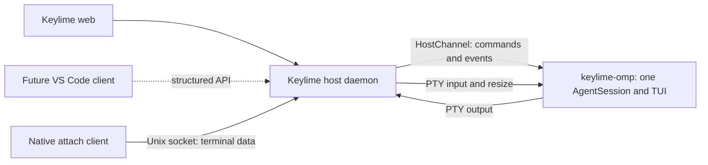

# Shared sessions and native terminal attachment

## Status

This is a proof of concept in the Keylime working tree, not a finished or deployed feature. It was implemented directly on `main`; move the changes to a feature branch before continuing. No automated tests, compatibility work, or release documentation were added as part of the proof.

The goal is one live OMP session that can be used from Keylime, the native OMP TUI, and eventually other clients at the same time. The proof starts the real OMP TUI in a PTY and exposes the same session through Keylime's existing structured channel. It does not modify upstream OMP, implement a new TUI, or require a terminal multiplexer.

## How to try it

Start the updated Keylime host from this checkout and start or resume a session in Keylime. On the same host, in a terminal or an SSH session, run:

```sh
cd /Users/matt.cowger/workspace/keylime
bun bin/keylime.ts attach <session-id>
```

`Ctrl-]` detaches without intentionally ending the session. Quitting OMP itself ends that runtime for all attached clients. An installed Keylime binary must be rebuilt before it can contain these changes; the proof used the checkout and the existing compiled `keylime-omp` runner.

The attach command requires a TTY and access to the host daemon's local Unix socket. It is not a TCP/WebSocket remote terminal client. A session must have been started by the updated daemon's PTY launch path; this command does not attach the TUI to an already-running headless process, a stock OMP process, or an arbitrary session file.

## Architecture



There is one `AgentSession` and one agent loop per runtime. Keylime sends commands and receives session events over the structured channel. Terminal input and output use a separate PTY channel. The web UI does not scrape terminal output, and the terminal client contains no agent logic or OMP UI implementation.

A browser message enters the same session displayed by the TUI; a message entered in the TUI is emitted on the structured channel for Keylime. The terminal runs on the host, so OMP commands and tools operate there. Multiple structured clients remain possible through the existing channel member and event fan-out. Multiple terminal attachments share the same PTY and therefore the same screen, input stream, and dimensions; the latest resize affects the shared PTY. Independent terminal views and resize arbitration are not implemented.

## Launch and identity

1. `lib/hosts/daemon.ts` creates `SessionPtyManager` and starts its attach socket alongside the existing OMP host socket.
2. The daemon uses `prepareInteractiveLaunch` in `lib/hosts/local-host.ts` to resolve the runner, working directory, environment, session arguments, model, profile, and workspace launch configuration. It launches the runner **without** `--headless` in a PTY. This changes the daemon's normal session launch path; it is not an opt-in mode.
3. `runner/src/session.ts` already wraps the TUI's `AgentSession` with `HostChannel`. The runner connects to the host socket and sends its existing `hello` frame.
4. The daemon matches that hello to its pending PTY launch by PID. It completes the pending launch instead of treating the connection as an externally started TUI or creating a second channel. A separate runtime UUID identifies the PTY and channel after association.
5. `ChannelTable` binds the session ID to that runtime, including when the session identity changes. Attach resolves the session ID through this mapping. The runner's structured channel still addresses the same `AgentSession` as the TUI.

A failed or timed-out launch terminates its child. The daemon owns managed PTY processes; loss of the managed runner's host socket terminates that process. Daemon shutdown closes attachments and stops managed PTYs. The existing adoption path for independently started TUI runners is separate from the managed PTY path.

## Terminal attachment

`lib/hosts/session-pty.ts` owns each PTY, an `@xterm/headless` screen, a serializer, and its attached sockets. It starts at 80 columns by 24 rows with `TERM=xterm-256color` and `COLORTERM=truecolor`. The first attach supplies the client dimensions and resizes both the screen and PTY.

The emulator consumes output continuously, even with no native terminal attached. On attach, the manager drains queued screen writes, resizes, serializes the current screen, and sends a snapshot before adding the socket to live output delivery. Output messages and snapshots include a cursor. The current client writes frames in order; it does not implement cursor-based replay or recovery.

`bin/keylime-attach.ts` switches the local TTY to raw mode, enters the alternate screen, writes the snapshot and later output, forwards input and resize events, and restores terminal state on detach or exit. `bin/keylime.ts` dispatches the `attach` subcommand.

### Terminal queries and capabilities

The server-side emulator is the terminal-query responder, both before and after a client attaches. The PTY manager feeds output to the emulator and writes its replies back to the PTY. `ControlFilter` retains incomplete escape sequences across chunks and filters selected terminal queries from client output and selected reply sequences from client input. OSC palette and foreground/background/cursor color replies are implemented in the manager.

This is a deliberately narrow terminal-protocol implementation, not a guarantee of full terminal fidelity. In particular, the filter suppresses Kitty keyboard protocol and `modifyOtherKeys` negotiation because the headless emulator does not implement them. Input filtering also removes OSC and DCS sequences. The screen serializer and mode restoration need broader validation for clipboard, images, mouse, paste, keyboard protocols, terminal queries, and terminal-specific extensions. Do not replace the filtering with regex substitutions over arbitrary chunks: escape sequences can be split across writes, and two responders can corrupt cursor and capability state.

## Protocols

### Existing structured channel

This proof reuses Keylime's runner-to-host NDJSON protocol; it does **not** add OMP RPC mode or change the runner protocol version. `HostChannel` sends `hello`, session events, UI requests, and responses; the host sends commands and UI answers. Existing fan-out, message correlation, pending-dialog handling, and streaming snapshots remain in the Keylime channel layer. Dialogs mirrored between the local TUI and host settle on the first answer.

The important change is transport topology: daemon-spawned sessions now have a PTY for the TUI and use the runner's Unix-socket `HostChannel`, rather than the headless runner's stdio channel. `runner/src/channel.ts` documents the existing frames.

### New local attachment protocol

The daemon listens at the OMP host socket path plus `.attach`. The normal host socket is `KEYLIME_HOST_SOCKET` when set, otherwise `<XDG_RUNTIME_DIR or OS temp dir>/keylime/host.sock`. The attachment socket and its directory are restricted to the host user; this is local filesystem access control, not a network authentication protocol.

The attachment connection is newline-delimited JSON. The current messages are:

| Direction | Message | Purpose |
| --- | --- | --- |
| Client → daemon | `{ "type": "hello", "sessionId": "…", "cols": 80, "rows": 24 }` | Resolve a running session and begin attachment. |
| Daemon → client | `{ "type": "snapshot", "data": "…", "cols": 80, "rows": 24, "cursor": 0 }` | Restore the current terminal screen. |
| Daemon → client | `{ "type": "output", "data": "…", "cursor": 1 }` | Deliver subsequent terminal output. |
| Client → daemon | `{ "type": "input", "data": "…" }` | Forward terminal input to the PTY. |
| Client → daemon | `{ "type": "resize", "cols": 100, "rows": 30 }` | Resize the shared screen and PTY. |
| Client → daemon | `{ "type": "detach" }` | Close this attachment, not the OMP process. |
| Daemon → client | `{ "type": "exit", "code": 0 }` or `{ "type": "error", "message": "…" }` | Report process exit or an attachment error. |

This protocol is internal to the proof: there is no version negotiation, network listener, reconnect protocol, or public client SDK. A separate remote client would need an authenticated transport and a way to resolve the correct host and runtime; merely forwarding this local socket to a network is not a complete security design.

## Other clients

A VS Code extension should normally use the **structured Keylime interface**, not the terminal attachment protocol. It can submit session commands through `POST /api/agent/[id]` and consume the existing event-stream subscription machinery. `GET /api/events` opens an SSE connection, and `POST /api/events` attaches subscriptions to that connection; subscribing alone observes an existing managed session and does not start one. See `app/api/agent/[id]/route.ts`, `app/api/events/route.ts`, and `lib/event-stream-protocol.ts` for the actual contracts.

A future client needs session discovery, authentication, snapshots/reconnect, command correlation, and handling for interactive UI requests. These are client-integration tasks, not reasons to start another OMP process. The current proof has **not** implemented or tested a VS Code client. A terminal-style remote client could instead speak the attachment protocol over a suitably secured transport, but would inherit its shared-screen and terminal-fidelity limits.

## Lifecycle

`ChannelLifecycle.setTerminalAttached` prevents idle and abandoned reaping while at least one native terminal is attached. Terminal attachment does not make the agent itself non-idle. When the last terminal disconnects, normal timers restart with fresh windows. Explicit process exit, host shutdown, and other explicit stop paths still apply. A web connection and a terminal connection do not own one another.

There is no additional persistence layer. Screen state and the session-to-runtime mapping are in memory and disappear with the host process. OMP's normal session storage remains separate from the live process. A later launch may resume a saved session, but it is a new runtime, not an attachment to the process that exited.

## Verification performed

An isolated Keylime web server and host were started from the checkout, using the existing runner binary and a real model endpoint. The manual proof observed:

- A browser-started session attached from a native PTY client.
- Browser messages and a model response displayed in the TUI.
- A TUI message and model response displayed in the browser.
- Resizing, `Ctrl-]` detach, continued browser use, and reattachment to the current screen.
- Idle and abandoned lifecycle protection with shortened timers, followed by normal reaping after detach.

The native attachment was exercised in a PTY with a headless terminal emulator, not across a matrix of physical terminals. The first isolated run encountered provider setup and an unrelated provider credit error; the successful exchange used a configured real provider. No automated test suite, production binary build, network attachment, VS Code client, or full terminal-capability matrix was run.

## Next steps

1. Move the uncommitted proof off `main` to a feature branch, then review the implementation and decide whether PTY-backed launch should be the default or an explicit mode.
2. Add focused integration coverage for browser-first and terminal-first flows, one runtime per session, launch/hello races, session switches, duplicate launches, failures, shutdown, and reattachment. Exercise terminal input and structured commands concurrently.
3. Test lifecycle with real attachment/disconnection, multiple clients, idle and abandoned deadlines, explicit shutdown, and host/runner crashes. Verify that first-answer-wins dialogs dismiss correctly on every interface.
4. Test the terminal protocol across real terminal emulators and fragmented control sequences. Cover resize, snapshots and mode restoration, keyboard shortcuts, paste, mouse, clipboard, images, output backpressure, slow clients, and reconnect. Decide how to handle multiple terminals with different sizes.
5. Define the attachment protocol's versioning, limits, authentication, session discovery, and remote transport before exposing it outside the local host. Preserve the single query responder and verify that filtered sequences cannot cause duplicate replies or lost input.
6. Verify structured-client behavior for VS Code, including history, live updates, command responses, dialogs, disconnect/reconnect, and session changes. Publish a stable client-facing API only after those contracts are settled.
7. Update user and developer documentation, CLI help, API/protocol documentation, and changelog; build and smoke-test source and packaged installations before deployment. No release artifacts were built for this proof.
